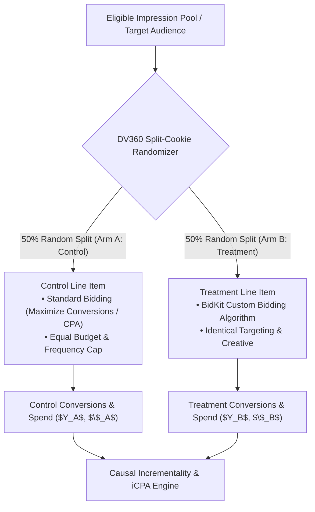
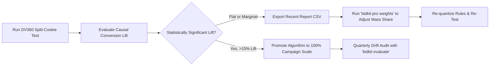

# DV360 Custom Bidding A/B Testing & Empirical Lift Playbook

> A methodological guide for quantitative traders, programmatic leads, and media agencies to measure true causal incrementality when deploying custom bidding algorithms on Google Display & Video 360.

---

## 1. The Attribution Fallacy in Custom Bidding

When media agencies deploy a new DV360 Custom Bidding algorithm, reporting dashboards frequently display impressive topline metrics: higher reported ROAS, lower CPA, or increased conversion volume.

However, offline simulation and correlational observational reporting do **not** answer the fundamental counterfactual question:

$$\text{Lift} = Y_{\text{Treatment}} - Y_{\text{Control}} \quad \text{under identical market supply and pricing}$$

### The Three Observational Traps
1. **Selection Bias & Cherry-Picking:** A custom algorithm trained on high-scoring impressions will naturally bid aggressively on users already exhibiting high organic conversion propensity (e.g. recent site visitors or brand-loyal users). The algorithm captures credit for conversions that would have occurred without advertising.
2. **Proxy Cannibalization:** When high-funnel proxies (such as viewability or Add-to-Cart) are blended into the script, standard reporting may show massive increases in proxy events while net macro-conversions remain flat.
3. **Market Supply & Pacing Drift:** Comparing pre-deployment performance with post-deployment performance conflates seasonal demand, competitor bid dynamics, publisher CPM shifts, and platform pacing changes.

To prove actual enterprise value from `dv360-bidkit` or `dv360-bidkit-pro`, teams must execute **randomized controlled experiments**.

---

## 2. DV360 Experiment Architecture: Audience Split-Cookie Tests

Google Display & Video 360 provides native support for **Experiments** (split-cookie A/B testing). This is the gold standard for comparing custom bidding against baseline heuristics.

### Protocol Checklist for Clean Experiment Setup
1. **Split-Cookie Partitioning:** Configure a 50/50 randomized split within DV360's Experiment tool. Do not split by geo or line item targeting, as demographic and CPM variance will introduce uncorrectable confounding.
2. **Variable Isolation:** Ensure both line items share identical:
   - Creatives and ad formats (same display/video dimensions and tags).
   - Frequency caps (e.g., 3 impressions per user per 24 hours).
   - Domain / App allowlists and blocklists (trafficked from `targeting_block_request.csv`).
   - Daily flighting and pacing schedules (evenly distributed spend).
3. **The Sole Differentiator:** The bidding strategy.
   - **Control Arm:** DV360 Standard Bidding (*Maximize Conversions* or *Target CPA*).
   - **Treatment Arm:** Verified BidKit Custom Bidding DSL script.

---

## 3. Pre-Flight A/A Validation Phase

Before deploying a custom algorithm into the treatment arm, run a **7-day A/A test**:

- Assign both Arm A and Arm B identical standard bidding strategies.
- Measure baseline CPA, conversion counts, CPM, and reach across both arms.
- Confirm that the difference between arms is statistically indistinguishable from zero ($p > 0.10$):

$$| \text{CPA}_A - \text{CPA}_B | < \epsilon$$

> [!IMPORTANT]
> If the A/A test reveals a statistically significant discrepancy prior to algorithm deployment, the underlying audience split is unbalanced. Re-randomize the split cookie segments before proceeding.

---

## 4. Sample Size & Statistical Power (MDE)

To ensure the experiment can detect a true difference in cost-per-acquisition or conversion rate, calculate the Minimum Detectable Effect (MDE) in advance.

For testing differences in conversion rate with statistical power $1 - \beta = 0.80$ and significance level $\alpha = 0.05$ ($z_{\alpha/2} = 1.96, z_\beta = 0.84$):

$$n \ge \frac{2 \cdot (1.96 + 0.84)^2 \cdot p(1 - p)}{\delta^2} \approx \frac{15.7 \cdot p(1 - p)}{\delta^2}$$

Where:
- $p$ is the baseline conversion rate (e.g., $0.02$).
- $\delta$ is the minimum absolute difference you need to detect (e.g., $0.003$ for a 15% relative lift).
- $n$ is the minimum required impressions per arm.

### Rule of Thumb for Programmatic Traders
- **Conversion Volume:** Aim for at least **400–500 conversions per arm** during the test window.
- **Test Duration:** Minimum **14 days** (to span at least two full weekly cycles and mitigate day-of-week seasonality).
- **Avoid Premature Peeking:** Do not terminate the experiment early upon observing initial positive spikes; allow the DV360 pacing controller ($\alpha_t$) to stabilize.

---

## 5. Computing Causal Metrics: iCPA and Incremental ROAS

Once the experiment reaches statistical maturity, compute true causal performance:

### 1. Incremental Cost Per Acquisition (iCPA)
$$\text{iCPA} = \frac{\text{Spend}_{\text{Treatment}} - \text{Spend}_{\text{Control}}}{\text{Conversions}_{\text{Treatment}} - \text{Conversions}_{\text{Control}}} = \frac{\Delta \text{Spend}}{\Delta \text{Conversions}}$$

If both arms spent equal budgets ($\Delta \text{Spend} \approx 0$), causal efficiency simplifies to percentage conversion lift:

$$\text{Causal Lift (\%)} = \frac{\text{Conversions}_{\text{Treatment}} - \text{Conversions}_{\text{Control}}}{\text{Conversions}_{\text{Control}}} \times 100$$

### 2. Welch's Two-Sample t-Test for Significance
For continuous transaction values (Floodlight revenue), compute the standard test statistic:

$$t = \frac{\bar{X}_T - \bar{X}_C}{\sqrt{\frac{s_T^2}{n_T} + \frac{s_C^2}{n_C}}}$$

Reject the null hypothesis of equal performance if $|t| > 1.96$ ($p < 0.05$).

---

## 6. Feedback Loop: Recalibrating with `bidkit-pro weights`

Empirical test results directly inform algorithm refinement:

1. **If Treatment Outperforms Control ($p < 0.05$):**  
   Scale the treatment custom bidding script to 100% of line item budget. Maintain a 5% continuous holdout to monitor longitudinal performance.
2. **If Treatment is Flat:**  
   Inspect proxy conversion correlation. Run `bidkit-pro weights` on the recent campaign report to verify that proxy signals (e.g. viewable impressions) are not cannibalizing macro-conversion score mass. Rebalance target macro mass share from $65\%$ to $80\%$.
3. **Continuous Maintenance:**  
   Every 90 days, re-run `bidkit evaluate` against the latest 30-day report to ensure publisher score distributions and positive rates remain within healthy Google S2 training boundaries.
