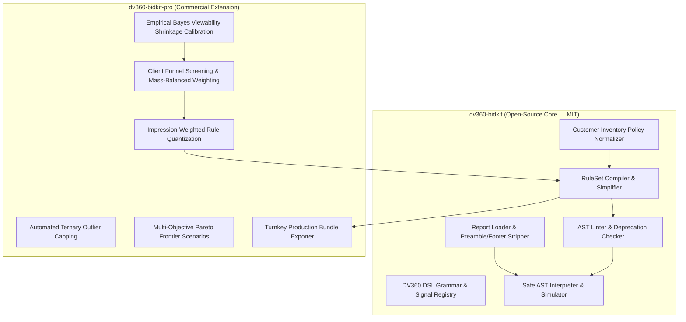

# DV360 BidKit Documentation

**DV360 Custom Bidding DSL Linter, Pre-Flight Simulator, and Rule Compiler**

`dv360-bidkit` provides an open-source MIT-licensed toolkit for engineering, validating, and compiling Google Display & Video 360 (DV360) custom bidding algorithms.

---

## Architecture: Open-Core vs. Pro

`dv360-bidkit` follows an open-core architecture where the fundamental compiler, grammar validator, and local AST execution engine are open-source, while algorithmic calibration and funnel optimization are commercial:

---

## Signal Registry Reference (Google 2026.1 Specification)

| Signal / Function | Kind | Return Type | Google Spec Reference | Status | Notes |
|---|---|---|---|---|---|
| `first_match_aggregate` | Aggregation | `float` | S1 | Verified | Sequential evaluation returning first matched criteria weight |
| `sum_aggregate` | Aggregation | `float` | S1 | Verified | Sums matched condition weights |
| `max_aggregate` | Aggregation | `float` | S1 | Verified | Returns highest matched weight |
| `total_conversion_count` | Function | `float` | S1 | Verified | Count of conversions for Floodlight activity ID and model ID (0=last touch) |
| `total_conversion_value` | Function | `float` | S1 | Verified | Monetary revenue value for Floodlight sales activity |
| `total_conversion_quantity` | Function | `float` | S1 | Verified | Total transaction item quantity for Floodlight activity |
| `conversion_custom_variable`| Function | `str` | S1 | Verified | Value of Floodlight custom variable (`u_variable_index`) |
| `ga4_conversions_count` | Function | `int` | S1 | Verified | Count of GA4 events for `property_id` and `conversion_event_name` |
| `domain` | Dimension | `str` | S1 | Verified | Normalized domain hostname (app bundle ID on Connected TV) |
| `site_id` | Dimension | `int` | S1 | Verified | DV360 site identifier |
| `device_type` | Dimension | `int` | S1 | Verified | 1=Desktop, 2=Smartphone, 3=Tablet, 4=Connected TV |
| `environment` | Dimension | `int` | S1 | Verified | 1=Web, 2=App |
| `country_code` | Dimension | `str` | S1 | Verified | ISO 3166-1 alpha-2 country code |
| `line_item_id` | Dimension | `int` | S1 | Verified | DV360 Line Item ID |
| `advertiser_id` | Dimension | `int` | S1 | Verified | DV360 Advertiser ID |
| `browser_id` | Dimension | `int` | S1 | Deprecated | Removed from recent DV360 API releases |

---

## Google S2 Pre-Flight Training Readiness Standards

DV360 models require sufficient positive score historical density over the relevant lookback window (typically 30 days):
* **Advertiser minimum:** $\ge 500$ positively scored impressions across the advertiser.
* **Line item minimum:** $\ge 50$ positively scored impressions per active line item.
* **Score Distribution Health:**
  * Positive Scoring Rate: $5\% \text{ to } 40\%$ (lower risks cold-start starvation; higher risks uninformative bidding).
  * Max-to-Median Score Ratio ($\max / \text{median}$): $\le 20.0\times$ (higher destabilizes DSP daily pacing controllers).
  * Gini Inequality: $0.25 \text{ to } 0.65$ (reflects clear publisher tiering without extreme winner-takes-all distortion).

---

## Command Reference

### `dv360-bidkit` (Core)
* `bidkit demo [--out-dir <dir>]`: Generate synthetic demo fixtures and run an instant pre-flight diagnostic simulation.
* `bidkit lint <script.py> [--format text|json]`: Validate script syntax against AST rules and the 2026.1 signal registry.
* `bidkit compile --rules <rules.json> [--policy <policy.csv>] [--out <script.py>]`: Compile structured rules into production DSL.
* `bidkit evaluate <script.py> --report <report.csv> --mapping <mapping.json> [--out <diagnostics.json>]`: Simulate script performance on historical data.
* `bidkit report <diagnostics.json> [--out <audit.html>]`: Render visual HTML audit report.

### `dv360-bidkit-pro` (Pro)
* `bidkit-pro auth [--key <key>]`: Authenticate commercial license with Polar.sh.
* `bidkit-pro weights --report <report.csv> --mapping <mapping.json> --macro "<col>" --proxies "<col1,col2>" [--out <weights.json>]`: Screen proxies and compute mass-balanced weights.
* `bidkit-pro build --report <report.csv> --mapping <mapping.json> --config <campaign.json> [--weights <weights.json>] [--policy <policy.csv>] [--out-dir <bundle_dir>]`: Export turnkey 8-artifact production bundle.
